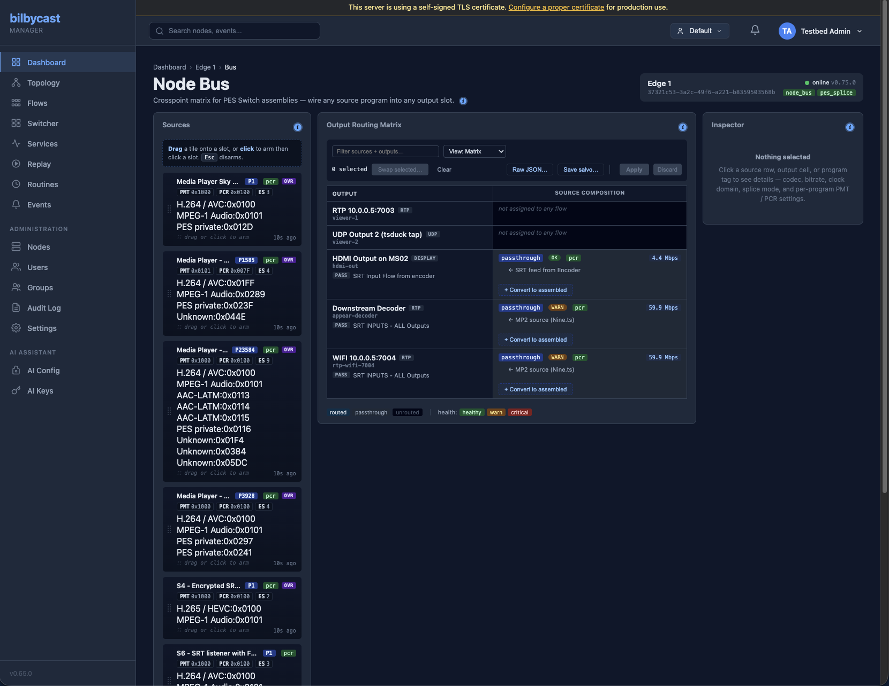

The **Node Bus Matrix** is bilbycast-manager's authoring surface for the node-wide elementary-stream bus. It turns one edge into a full distribution matrix — every input's programs can feed any output's [assembled flow](/edge/flow-assembly/), receivers stay locked through a Take, and the operator works on a crosspoint matrix that mirrors the way a routing-engineer thinks.



It replaces the legacy per-flow assembly form. On the flow modal you now see a small `Assembly: N programs / M slots — [Open in Node Bus →]` summary card; everything below the surface lives on `/nodes/<id>/bus`.

## Why it matters

Before, building an assembled flow meant opening the flow modal, expanding a nested form, navigating `programs.0.streams.1.source.primary`-style paths, and picking from a list that only showed inputs the flow owned. Cross-flow PIDs were invisible. Clock-domain mismatches surfaced only after a failed save.

The Node Bus Matrix flips this around:

- Every input's program on the node shows up in the left pane as a tile, with clock identity, codecs, and live PSI staleness.
- Every output that runs an assembled flow shows up as a row in the matrix, with one cell per program.
- Wire a source onto a destination by clicking (or dragging) — Lawo-style orange marks pending changes; blue marks committed state.
- A clock check refuses a program that would play inputs on different clocks at the same time *before* it reaches the edge, naming the slots, so an operator can't accidentally commit a mix the edge would reject. Switching a whole program between two encoders is not such a mix: see [Clocks](#clocks).
- A single Apply (N) commits every pending route atomically per flow.

This is the operator workflow for **PES Switch** — see [Flow Assembly (PID Bus)](/edge/flow-assembly/#splice-strategy--splice_mode) for the splice strategies the matrix wires together.

## Three-pane layout

```
Sources (28%)              Matrix (50%)                   Inspector (22%)
─ programs-list ─          ─ crosspoint cells ─           ─ context detail ─
program tiles              one row per output             clicked source / cell
clock chip                 cells = per-program blocks     / program → render
codec pills                pending = orange, server = blue   appropriate form
                           Apply / Discard toolbar
```

### Sources pane

Every program currently visible across the node's TS-bearing inputs. Each tile carries:

- **Master-clock chip** — `[ptp]`, `[pcr]`, or `[wallclock]` — so the operator sees at a glance which sources are co-clocked.
- **Per-stream pills** — codec + PID, colour-coded by kind (video / audio / subtitle / data).
- **Staleness fade** — after 60 s without a PSI catalogue refresh, the tile dims so a stale source can't accidentally be wired live.

A 120 ms-debounced search box at the top filters source tiles AND output rows in one keystroke.

### Matrix pane

One row per output that runs an assembled flow. Cells render per-program blocks; each block lists its slots' `out_pid`, `stream_type`, and current source label. Cells with pending changes turn Lawo orange via the `.pending` class; committed cells render blue.

Two equally first-class authoring entry points:

- **Click-to-wire** — click a source tile to arm it (chip in toolbar shows the armed label). Then click any empty / replaceable cell to wire `SlotSource::Pid` into pending state, kind-matched against the slot's `stream_type`. Esc disarms.
- **Drag-and-drop** — source tiles are `draggable`. Dragging auto-arms; dropping on a `[data-drop-target="cell"]` element wires. Cells light up `.drop-eligible` / `.drop-active` during dragover.

Authoring affordances inside the matrix:

- **`+ Add program`** button at the bottom of every assembled-output row. Auto-picks the next free `program_number` and PMT PID; PCR source defaults to `auto`; `streams` starts empty.
- **`+ Add slot`** button inside each program block. Auto-picks the next free `out_pid` and defaults `stream_type` to H.264.
- **`+ Convert to assembled`** button on passthrough rows. Builds the program(s) from the active input's PSI: Switch slots across the flow's inputs that carry each of the program's streams (kind and codec, in the program of the same number), pinned slots otherwise (see [Clocks](#clocks)). Confirms first, naming the inputs the program will switch between and what the others lack, then PUTs the whole flow via the full `update_flow` path (passthrough ↔ assembled can't be hot-swapped, so the flow restarts; the confirmation says so).
- **`↩ Convert to passthrough`** button on assembled rows — the reverse. Confirms, then PUTs the *whole* flow with its `assembly` block deleted down the same full `update_flow` path: the synthesised PAT/PMT and every program / slot definition is discarded and the flow forwards its active input's bytes unchanged, so it restarts too. Any pending (unapplied) assembly staged for that flow is dropped on success, so a later Apply can't silently revert the conversion.

### Inspector pane

Context-sensitive form for the most-recently-clicked source / cell / program:

- **Clicked source** — full PSI breakdown (PMT PID, PCR PID, per-stream `stream_type` + label).
- **Clicked cell (slot)** — **Rewire source** (the exact program and PID) and **Switching**: legs on several of the flow's inputs, the initial leg, `splice_mode` (`pmt_bump` / `pes_aligned`) and `splice_budget_ms`. **Make switchable** stages this slot. On an edge after v0.117.0 each leg shows its PID (and the program it is of, where that is not plain), and **Make whole program switchable** stages every slot of the program on the ticked inputs, or says which input has no stream for which slot. While a plan is staged, the pane lists the slots a Take would leave behind on another clock and what applying it cuts, or can cut, to another input, and the matrix outlines those slots in red. Everything stages into pending state for the same `Apply (N)` button as wiring.
- **Clicked program** — editable `pmt_pid` and `pcr_source` (a slot with one PID, or a Switch slot).
- **Live lipsync trim** — hits `POST /api/v1/nodes/<id>/flows/<id>/master-clock/lipsync` immediately (live action, no pending stage), ±200 ms.

## Clocks

Inputs that play together in one program must run on one clock: one PTP domain (ST 2110, MXL), WebRTC / WHEP inputs, or one input, since every other input has the clock of its own source. The programs of an MPTS are independent of each other.

An edge after v0.117.0 judges only what can play **at the same time**. The legs of a Switch slot are alternatives, so a program can switch between two encoders as long as all of it follows every Take: give every slot of the program legs on the same inputs and one initial leg. A program a Take would split, with a pinned slot, a Hitless slot or a Switch slot without that leg staying behind on another clock, is refused with `pid_bus_master_clock_mismatch`, by the manager before it is sent and by the edge. An edge up to v0.117.0 refuses a program whose slots name inputs on different clocks, the legs of a Switch slot included: the manager says so, and the Inspector offers legs on the slot's own clock only. The rest of this section is about an edge after v0.117.0.

A Take between clocks is a cut, and holds the program for the new input's first PCR on the leg of the slot that carries the program's PCR. The Inspector proposes the PID each input sends its PCR on for that slot, and warns where an input sends it elsewhere (a PID of its own, or its audio): a Take to that input keeps the program off air until a Take to one that sends it there, with Warning `pid_bus_take_no_pcr`.

The legs of one slot must be of one codec: the slot goes out under its own `stream_type` whichever leg is on air, so a Take from an H.264 leg to an HEVC one goes out mis-signalled. Converting a flow and **Make whole program switchable** leave such an input out; the Inspector warns of a leg of another codec, and of one stream going out on two slots.

A slot that becomes a Switch slot starts on the input the other Switch slots of its program are on, where it has a leg on it. In a program that had none it starts on the input the flow was started on where it has a leg on it, and on its initial leg where not. No Take moves that input (one on a pinned program re-points the program), so making a program switchable can cut it back to it. The manager knows only the flow's active input, which is the same unless a Take has changed it since: the Inspector says before Apply what would be cut to the active input, or, where another program of the flow switches already, that the program can be cut.

An input with one program is offered for every program of the flow: an MPTS put together from single-program encoders, each sending program 1, switches any of its programs between them, and the row says which program it is (`P1`) where the number is another. An input with several is offered for the program of its number, and for another once a slot of that program is wired to the one wanted (**Rewire source**). Converting a flow to an MPTS pairs programs by number only.

## Pending state and Apply

`pendingAssemblies: Map<flow_id, FlowAssembly>` holds local edits. The toolbar shows `Apply (N)` / `Discard` whenever there is any pending route. Apply iterates each pending flow and PUTs `/api/v1/nodes/<id>/flows/<id>/assembly`; success clears the pending entry, failure surfaces in a toast carrying the `pid_bus_*` error code and what to do about it, and the slots a clock refusal names are outlined in the matrix until the message that names them (the toast, or the Raw JSON modal) is closed or the plan is edited again.

Per-flow atomicity is the contract: every slot in a flow either lands together or none of them do. Cross-flow Apply is multi-PUT — one flow can fail while sibling flows succeed; per-flow results land in the toast.

## Matrix ↔ Single-Bus view

A `#viewModeSelect` toolbar control toggles between the full matrix (every output × every program) and **Single-Bus** view (one output's full vertical assembly, focused). Per-user preference persists via `localStorage["bus_view_mode"]` + `["bus_single_output_id"]`.

## Raw JSON modal

`Raw JSON…` opens a textarea with the selected flow's `FlowAssembly` pretty-printed. Save validates `JSON.parse`, then PUTs to the same `/assembly` endpoint. Useful for scripted bulk paste; doesn't replace the matrix for everyday work.

## Save salvo — capture routing as a Switcher preset

`Save salvo…` captures the current matrix routing as `bus_route` action stubs and POSTs to `/api/v1/switcher/presets`. The operator names it (e.g. "Half-time tally", "Studio 1 mix"); the [Live Switcher](/manager/switcher/) can recall it later in one click, including the per-action `splice_mode_override` baked into the stub. Salvos respect the active-tenant group, so a Group-A operator's salvo never leaks into Group-B.

## Capability gating

The page is gated on the edge advertising `node_bus` on `HealthPayload.capabilities`. Edges below 0.63.0 don't show the matrix. The flow-modal summary card still renders the deep-link regardless — older edges just land on an empty matrix.

## Permissions

- **View** the matrix and PSI catalogue — Viewer+ in the node's owner group.
- **Wire** routes and Apply changes — Operator+ on every flow the matrix touches.
- **Add programs / Add slots / Convert to assembled / Convert to passthrough** — Operator+ on the destination flow.
- **Save salvo** — Operator+ in the preset's owner group, plus Operator on every action's target node.

Permissions are enforced server-side; the matrix UI surfaces a permission-denied chip on cells the operator can wire-preview but not commit.

## Composes with PES Switch

The matrix is the authoring surface; **PES Switch** is the on-the-wire splice strategy. Every Switch slot wired through the matrix accepts `splice_mode = pes_aligned` (audio waits for the next PES AU boundary; video waits for the next IDR; AAC ADTS / LATM and H.264 / HEVC SPS sentinels refuse on parameter mismatch and fall back to PmtBump with a structured Warning). Between inputs on different clocks every Take is a PmtBump cut whatever the mode, since their timestamps cannot be compared: a `pes_aligned` slot raises Warning `pes_splice_degraded` with reason `independent_clocks`. Per-switch `splice_mode_override` on a Switcher preset action overrides each slot's config-time mode for a single Take. See [Flow Assembly — Splice strategy](/edge/flow-assembly/#splice-strategy--splice_mode).

## Related

- **[Flow Assembly (PID Bus)](/edge/flow-assembly/)** — the edge-side runtime: per-flow assembly modes, slot sources, hot-swap semantics, validation rules, PES Switch splice strategies.
- **[Live Switcher](/manager/switcher/)** — PGM/PVW director console. The Switcher's `activate_input` / `bus_route` actions drive Switch-slot active legs across flows.
- **[Routines](/manager/routines/)** — cron-scheduled fan-out that can recall a Switcher preset or fire a clip; chains naturally with salvos saved from the matrix.
